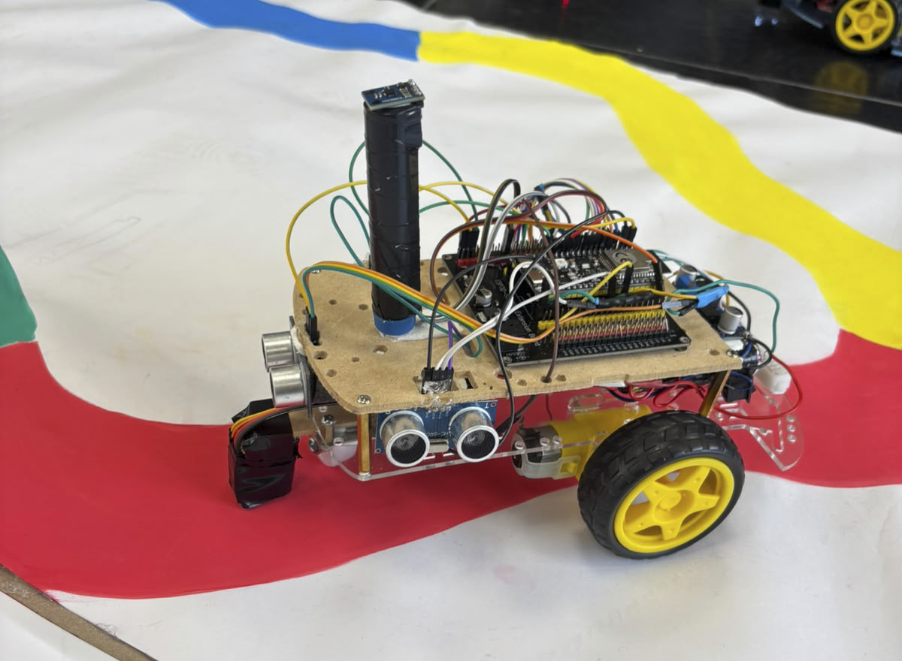
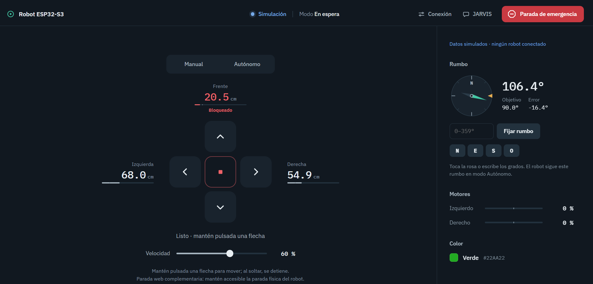

# Robot móvil inteligente con ESP32-S3

Proyecto de ingeniería mecatrónica (Universidad Militar Nueva Granada). Robot
móvil diferencial de 2 ruedas con ESP32-S3 que integra control manual, control
por voz, navegación autónoma, brújula digital, detección de colores, detección y
evasión de obstáculos, telemetría inalámbrica y un asistente tipo JARVIS.



> **Estado (2026-11-24):** el robot funciona: sensores, comunicación, control por
> voz, JARVIS y los tres submodos autónomos. La mayor dificultad es el
> seguimiento de línea en las curvas. Pendientes en
> [`docs/datos_pendientes.md`](docs/datos_pendientes.md).

---

## Estado del proyecto

| Elemento | Estado |
|----------|--------|
| Auditoría del proyecto | ✅ Completada |
| Repositorio y estructura | ✅ Creada |
| BOM (lista de materiales) | ✅ `hardware/BOM.xlsx` |
| Requisitos y trazabilidad | ✅ `docs/requisitos.md` |
| Arquitectura y pinout | ✅ `docs/arquitectura.md`, `hardware/pinout.md` |
| Protocolo de comunicación | ✅ `docs/protocolo_comunicacion.md` |
| Máquina de estados | ✅ `docs/maquina_estados.md` |
| Análisis de riesgos | ✅ `docs/riesgos.md` |
| Firmware principal (T-00/Fases 4-6) | ✅ `firmware/esp32s3_robot/` v0.4.0-nav (sensores, control manual, WiFi/WebSocket y navegador); compila |
| Módulos de sensores (Fase 4) | ✅ Brújula, color y 3× HC-SR04 funcionan en el robot (2026-11-24); color: 450 muestras, 100 % de aciertos |
| Control manual por serie | ✅ T-Manual-00 (2026-11-07, v0.2.0); revalidación por serie en v0.4.0-nav sin registrar |
| Protocolo, app web y JARVIS | ✅ Comunicación con el robot, voz y JARVIS funcionan (2026-11-24); modo simulación incluido |
| Pruebas de host (sin placa) | ✅ 9 pruebas ejecutadas, 0 fallos (2026-11-24) |
| Banco de pruebas de motores TT | ✅ `firmware/tt_motor_test/` (compila); ✅ probado en hardware (T-Motor-01) |
| Informe IEEE (final) | ✅ [`report/informe_final.pdf`](report/informe_final.pdf) |
| Informe de la segunda entrega | ✅ [`report/entrega2/`](report/entrega2/) |
| Montaje y pruebas en pista | ✅ Robot armado; los tres submodos funcionan. Línea: se perdió en 16 de 20 pruebas en curva (80 %): reconoce el color, pero al buscar gira más rápido de lo que el sensor tarda en leer (120 ms) |

---

## Hardware (resumen)

| Función | Componente elegido | Estado |
|---------|--------------------|--------|
| MCU | ESP32-S3 DevKit **N16R8** | 🔵 Disponible |
| Motores | TT reductor con encoder, 6 V, 110 rpm, 1:90 | 🔵 Disponible |
| Driver motores | **TB6612FNG** | 🔵 Disponible |
| Brújula | **GY-271 (QMC5883L)**, I²C | ✅ Funciona (2026-11-24) |
| Color | **TCS34725**, I²C | ✅ Funciona (2026-11-24) |
| Obstáculos | **3× HC-SR04** (ultrasónico: frontal, izquierdo, derecho) | ✅ Funciona (2026-11-24) |
| Batería | Li-ion **3S** + BMS + buck a 6 V/5 V | 🛒 A comprar |
| Chasis | Fabricado (acrílico) | 🛠️ Fabricar |

Detalle y precios en [`hardware/BOM.xlsx`](hardware/BOM.xlsx) y
[`hardware/bom.md`](hardware/bom.md). Conexiones en
[`hardware/pinout.md`](hardware/pinout.md).

**Decisión de entorno:** **Arduino framework (C++)**. Justificación en
[`docs/arquitectura.md`](docs/arquitectura.md).

---

## Estructura del repositorio

```
PROYECTO_LAB/
├── README.md
├── iniciar_app.bat      abre la app Streamlit (Windows)
├── firmware/            firmware principal y banco de pruebas de motores
├── app/
│   ├── streamlit/       app principal
│   ├── web/             interfaz web (v2/ es la que muestra Streamlit)
│   └── shared/          protocolo, voz, JARVIS y panel autónomo
├── hardware/            BOM y pinout
├── cad/                 vistas del modelo del chasis
├── imagenes/            interfaz y montaje
├── docs/                requisitos, protocolo, FSM, riesgos, documento técnico
├── report/              informe final y segunda entrega (LaTeX y PDF)
├── tools/               calibración de color y sus datos
└── tests/               pruebas que corren en el PC (sin placa)
```

---

## Puesta en marcha del firmware

1. Instala el **core ESP32** en Arduino IDE (Gestor de tarjetas, versión 3.3.x).
2. Abre `firmware/esp32s3_robot/esp32s3_robot.ino`.
3. Placa: **ESP32S3 Dev Module**. PSRAM: **OPI PSRAM**.
4. Compila y carga. Monitor serie a **115200**.

Compilación por línea de comandos (verificada en este entorno):

```powershell
$cli = "$env:LOCALAPPDATA\Programs\Arduino IDE\resources\app\lib\backend\resources\arduino-cli.exe"
& $cli compile --fqbn esp32:esp32:esp32s3:PSRAM=opi --warnings all firmware\esp32s3_robot
```

### Qué hace el firmware actual (v0.4.0-nav)

- Imprime un banner de arranque con la versión.
- Arranca con los motores en **estado seguro** (`STBY=LOW`).
- Ejecuta un **escáner I²C** e informa qué direcciones se detectan.
- Envía un **latido (heartbeat)** por serie cada segundo.
- Responde `PING` con `PONG` (comprobación de enlace).
- Lee **brújula** (rumbo), **color** (clasificación), **distancias frontal/
  izquierda/derecha** (3× HC-SR04 no bloqueantes, disparo escalonado) y
  **encoders** (opcional), todo de forma no bloqueante.
- Control manual por serie: `ARM`, `FWD`, `BACK`, `LEFT`, `RIGHT`, `L`, `R`,
  `STOP`/`DISARM`, con deadman de 10 s en movimiento y 30 s armado.
- Levanta un AP `robot-esp32s3` (password `robot1234`) y un servidor
  WebSocket en `ws://192.168.4.1:81`; acepta el protocolo JSON v1 y envía
  telemetría cada 200 ms.
- Comandos de red por serie: `NET`/`WIFI`/`WS` para consultar AP, STA, IP,
  canal y clientes WebSocket conectados.

⚠️ **Seguridad:** el firmware arranca en `STBY=LOW`; para moverlo hay que enviar
`ARM` y, en banco, levantar las ruedas. `STOP` desarma inmediatamente. Los
sensores no son necesarios para probar el control manual.

### Control manual por serie (T-Manual-00)

Carga `firmware/esp32s3_robot` y usa el monitor serie a 115200:

```text
ARM
FWD 20
STATUS
STOP
```

Resultado: T-Manual-00 **PASADA** (2026-11-07, v0.2.0): consignas aplicadas,
`STOP` deja `STBY=LOW` y el deadman detiene/desarma a los 3 s en movimiento y
10 s armado (hoy 10 s y 30 s, ver `Config.h`). Desde v0.3.0 la ruta serie pasa
por `FSMGlobal`; su revalidación no está registrada. La integración real con la
app funcionó el 2026-11-24.

### Servidor WiFi/WebSocket

El firmware levanta un AP propio y un servidor WebSocket en el puerto 81:

- SSID: `robot-esp32s3`
- Password: `robot1234`
- URL: `ws://192.168.4.1:81`
- Protocolo: JSON v1 ([`docs/protocolo_comunicacion.md`](docs/protocolo_comunicacion.md))
- Telemetría cada 200 ms; deadman WebSocket de 500 ms.

Estado: **la comunicación entre la app y el robot funcionó** (2026-11-24). No se
archivó log ni se midió la latencia.

### Calibración del sensor de color (T-Color-01)

Con el robot conectado por USB y el Monitor Serie de Arduino **cerrado**:

```powershell
python tools\calibrar_color.py            # o: --port COM17
```

Pide colocar cada color (negro, blanco, rojo, amarillo, verde, azul) en 3
posiciones, captura 25 lecturas por posición con el comando `SENSORS`, guarda un
CSV en `tools\datos_color\` y muestra el porcentaje de aciertos de los umbrales
actuales de `Config.h` y los rasgos medidos (clear, saturación, ratios). Si algún
color queda por debajo del 95 %, hay que ajustar los `TCS_*` de `Config.h` con
ese CSV. Un CSV ya capturado se puede volver a analizar con `--analizar <csv>`.

### Pruebas de host (sin placa)

```powershell
python tests\host\run_all.py
```

Ejecutan las 5 pruebas Python (ángulos, color, obstáculos, navegador autónomo y
lógica de la app Streamlit) y, si hay `node`, las 4 pruebas JS (protocolo, voz, JARVIS e integración WebSocket). Ver
[`docs/trazabilidad.md`](docs/trazabilidad.md).

### Pruebas de motores TT (TB6612FNG)

Sketch independiente para validar cableado, sentido de giro, PWM, STBY y
deadman. Se conserva como banco aislado; el firmware principal ya integra el
control manual:

```powershell
$cli = "$env:LOCALAPPDATA\Programs\Arduino IDE\resources\app\lib\backend\resources\arduino-cli.exe"
& $cli compile --fqbn esp32:esp32:esp32s3:PSRAM=opi --warnings all firmware\tt_motor_test
```

Arranca con los motores en seguro; hay que enviar `ARM` por el monitor serie
para habilitar el driver. Comandos: `FWD`, `BACK`, `LEFT`, `RIGHT`, `L`, `R`,
`TEST`, `STOP`. **Levanta las ruedas del suelo** y sigue la guía completa en
[`firmware/tt_motor_test/README.md`](firmware/tt_motor_test/README.md).

**Resultado:** T-Motor-01 **PASADA** (2026-11-07): sentidos, PWM, `STBY`,
`STOP` y deadman verificados. El motor derecho quedó invertido en el montaje y
se corrigió por software con `MOTOR_R_INVERT=1`.

---

## App Streamlit (principal)

App Streamlit con la **misma interfaz de `app/web/v2`**: `app/streamlit/app.py`
incrusta el HTML, CSS, JS y fuentes de v2 (y la lógica de `app/shared/`) y los
sirve tal cual, así que cualquier cambio en v2 se ve aquí sin tocar Python. La
interfaz habla con el robot por WebSocket (protocolo JSON v1): brújula con rumbo
actual y deseado, telemetría en vivo, control manual, modo autónomo, voz y
JARVIS. Doble clic en `iniciar_app.bat` para abrirla.

Panel alternativo con widgets nativos de Streamlit (gráfico polar Plotly, JARVIS
con estado completo y voz): `python -m streamlit run app\streamlit\app_nativo.py`.

```powershell
pip install -r app\streamlit\requirements.txt
python -m streamlit run app\streamlit\app.py
```

Conéctate a la WiFi `robot-esp32s3` y pulsa **Conectar** (`ws://192.168.4.1:81`),
o elige **Simulación** para probar sin placa. Para probar el cliente WebSocket
sin placa: `node tests\host\mock_robot_server.js` y la URL `ws://127.0.0.1:8765`.

### Modo autónomo: tres submodos (v0.4.0-nav)

Al elegir **Autónomo** la app pide un submodo, y el robot no arranca hasta pulsar
**Iniciar** (por voz, JARVIS lo pregunta):

| Submodo | Comportamiento | Serie |
|---------|----------------|-------|
| Solo esquivar | Avanza recto y esquiva | `AUTO EVADIR` |
| Rumbo | Mantiene con la brújula el rumbo dado y esquiva | `HEAD 90` y `AUTO RUMBO` |
| Línea | Sigue cualquier color menos blanco, rodea y vuelve | `AUTO LINEA` |

Firmware y app deben ser de la misma versión: el firmware rechaza el modo
autónomo sin submodo. Ver [`docs/maquina_estados.md`](docs/maquina_estados.md).



## App web de control (alternativa)

Panel HTML/JS que habla con el robot por WebSocket (protocolo JSON v1). Incluye
control manual, modos, voz, telemetría y JARVIS.

```powershell
python app\serve.py            # http://localhost:8000/web/index.html
```

Sin robot, activa **Modo simulación** en la interfaz. Detalles en
[`app/README.md`](app/README.md).

---

## Seguridad (reglas mínimas)

- **Nunca** conectes un motor directamente a un GPIO.
- Motores alimentados **desde la batería**, nunca desde el regulador del S3.
- **GND común** entre batería, driver y MCU.
- Estado seguro (motores detenidos) al arrancar, reiniciar y ante fallo de enlace.
- En el banco de motores, **levanta las ruedas** y envía `ARM` de forma explícita.
- No cargar la batería Li-ion sin supervisión.

---

## Repositorio y licencia

Proyecto académico. No subir credenciales, claves ni binarios innecesarios
(ver [`.gitignore`](.gitignore)).
